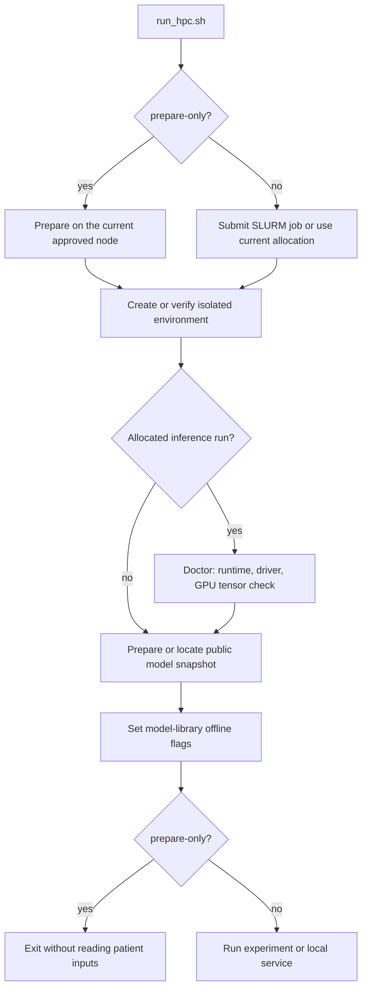

# Copilot execution harness: technical companion

This guide describes the code currently implemented in this repository and separates it from proposed hardening. The component consumes upstream model predictions, features, and context; it does not train the clinical, mIF, or fusion models, process raw images, or choose treatments. The selected NVIDIA model is a general-purpose instruction model, not a clinically validated model for this task. Its documented context length is 4,096 tokens. See the [NVIDIA model card](https://huggingface.co/nvidia/Nemotron-Mini-4B-Instruct).

The preceding local verification run passed **67 tests**. The current suite also contains 67 test methods. Those tests exercise contracts, deterministic/injected generation, mocked vLLM and download adapters, local HTTP, artifact creation, evaluation, and stubbed HPC orchestration. A real model load and generation on Moffitt's A30 remain unverified. The commands and acceptance rubric below make that remaining check concrete; they do not claim it has happened.

## 1. Execution boundaries and prerequisites

| Layer | Current requirement or behavior |
| --- | --- |
| Local synthetic runner | Existing Python 3.11+; no third-party packages, GPU, or model download. |
| GPU bootstrap | Linux `x86_64`, glibc >=2.28, environment modules, conda, `sha256sum`, and approved public-download access during first preparation. |
| Selected Python environment | Python 3.11, provided through `Anaconda3/2024.02-1` by default. |
| Direct runtime pins | vLLM 0.10.2; torch/torchaudio 2.8.0+cu128; torchvision 0.23.0+cu128; Transformers 4.55.2; Hugging Face Hub 0.34.4. |
| CUDA/driver pairing | CUDA 12.8 wheel runtime; the deployment's doctor requires NVIDIA Linux driver >=570.26. It does not install a driver. |
| GPU checks | Visible GPU, BF16 support, compute capability >=7.0, and at least 20 GiB total GPU memory; doctor also allocates and synchronizes a BF16 CUDA tensor. The intended device is an A30 with 24 GB VRAM. |
| SLURM defaults | `red`, `gpu:a30:1`, 32 GB host memory, four CPUs, four hours. |
| Selected public weights | `nvidia/Nemotron-Mini-4B-Instruct`, revision `791833e92ebddb0bc2c1007f6d2b6764f886a2ae`. |

The runtime pairing follows the version-specific [vLLM GPU installation guidance](https://docs.vllm.ai/en/v0.10.2/getting_started/installation/gpu.html) and [vLLM CUDA requirements](https://github.com/vllm-project/vllm/blob/v0.10.2/requirements/cuda.txt). NVIDIA lists 570.26 for CUDA 12.8 in its [CUDA release notes](https://docs.nvidia.com/cuda/archive/12.8.0/cuda-toolkit-release-notes/index.html). The chosen snapshot publishes a PyTorch binary checkpoint; the preparation filter includes those weight files. See the [pinned NVIDIA snapshot](https://huggingface.co/nvidia/Nemotron-Mini-4B-Instruct/tree/791833e92ebddb0bc2c1007f6d2b6764f886a2ae).

The runner purges site modules by default and loads the Python distribution module. It uses the matching pip wheel runtime instead of mixing the supplied CUDA 13 toolkit and site PyTorch 2.1.2 module. Direct dependencies are pinned; transitive dependencies are resolved at preparation time and recorded with `pip freeze`. That recording is not a complete, enforced environment lock.

Doctor checks compatibility and a small CUDA allocation. It does **not** load the model, validate its chat template, initialize guided decoding, reserve its full inference memory, or generate a narrative. Total GPU memory is checked, not guaranteed free memory at inference time.

Sources: [requirements-vllm.txt](/Users/4475918/Projects/temp/MyStudies_AppliedScripts/NVIDIA_Nemotron/requirements-vllm.txt), [models.py](/Users/4475918/Projects/temp/MyStudies_AppliedScripts/NVIDIA_Nemotron/src/icb_copilot/models.py:48), [run_hpc.sh](/Users/4475918/Projects/temp/MyStudies_AppliedScripts/NVIDIA_Nemotron/scripts/run_hpc.sh), and [hpc.env.example](/Users/4475918/Projects/temp/MyStudies_AppliedScripts/NVIDIA_Nemotron/config/hpc.env.example).

## 2. Public preparation and offline patient inference



The default command submits a job and returns its ID and log locations:

```bash
bash run_hpc.sh
```

The allocated job creates/reuses the environment, runs doctor, prepares/reuses the public model, and then executes the synthetic experiment. Submission success is not experiment completion. With `--command doctor`, the allocated path exits after doctor and skips model preparation.

For compute nodes without public-download access:

```bash
bash run_hpc.sh --prepare-only
bash run_hpc.sh --offline
```

`--prepare-only` prepares public software and weights on the current approved node without submitting a GPU job or reading patient records. It can therefore succeed without proving GPU inference. `--offline` requires a prepared environment with a matching setup fingerprint and a usable local model directory. The bootstrap uses a fail-fast setup lock and records the owning host, PID, and job ID. If a lock is stale, verify its recorded owner is no longer active before removing it.

The setup fingerprint covers the requirements file, Python version, module, and selected wheel index. It is not a hash of every installed binary or all runner logic. Reused environments check the selected core package versions; model preparation records the requested revision and nonempty weight filenames/sizes. A manually supplied local model directory may have an unrecorded revision. The runtime's directory/configuration checks and prepared manifest are not a complete cryptographic verification of all weight contents.

Every experiment/service run uses a local model path with `HF_HUB_OFFLINE=1`, `TRANSFORMERS_OFFLINE=1`, telemetry opt-outs, and `trust_remote_code=False`. The selected code path does not call a hosted LLM API. These are **application and library settings**, not a firewall, network namespace, or network-egress guarantee. Real patient storage, node access, and any site-level isolation remain the HPC deployment's responsibility.

Source: [run_hpc.sh](/Users/4475918/Projects/temp/MyStudies_AppliedScripts/NVIDIA_Nemotron/scripts/run_hpc.sh:151), [prepare_model](/Users/4475918/Projects/temp/MyStudies_AppliedScripts/NVIDIA_Nemotron/src/icb_copilot/models.py:17), and [VLLMBackend](/Users/4475918/Projects/temp/MyStudies_AppliedScripts/NVIDIA_Nemotron/src/icb_copilot/backends.py:40).

## 3. Input contract, join semantics, and limits

The validator normalizes each record and rejects unsupported fields. Modalities are exactly `clinical`, `mif`, and `fused`; adding H&E requires a contract/adapter change. The positive class is always **ICB responder**. Upstream producers must verify class order and convert a non-responder score if necessary; this harness cannot infer class semantics.

| Field | Type, default, and enforced limit |
| --- | --- |
| `schema_version` | String `"1.0"`; defaults to `"1.0"`. |
| `patient_id` | Required string, <=100 characters; starts with a letter/number and uses only letters, numbers, `_ . : -`. |
| `predictions` | Required nonempty object containing any subset of the three supported modality keys. |
| `predictions.<modality>.probability` | Required finite numeric value in `[0,1]`. Booleans and string numbers are rejected in canonical JSON. |
| `model_id` | Nonempty string, <=160 characters; default `"unspecified"`. |
| `calibration` | `"unknown"`, `"uncalibrated"`, or `"calibrated"`; default `"unknown"`. It is producer metadata, not an assessed property. |
| `decision_threshold` | Finite number in `[0,1]`, or `null`/omitted. Classification is `score >= supplied_threshold`; no default threshold is inferred. |
| `top_features` | Optional object keyed by an available prediction modality; <=10 unique feature names per modality. |
| Feature `feature` | Required nonempty string, <=160 characters. |
| Feature `value` | Finite number, string <=256 characters, boolean, or `null`; omission normalizes to `null`. |
| Feature `unit` | String <=80 characters; default empty string. |
| Feature `direction` | Nonempty string <=160 characters; default `"not supplied"`. Describes the measurement. |
| Feature `attribution` | Optional/`null`, or object with nonempty `method` <=80 characters, finite signed numeric `value`, and nonempty `scale` <=80 characters. |
| `clinical_context` | String <=2,000 characters; default empty string. |
| `response_definition` | Nonempty string <=500 characters; default `"Not specified"`. |
| `ground_truth` | Integer `0` or `1`, or `null`/omitted. Booleans are rejected. |
| `evaluation_partition` | `unspecified`, `train`, `validation`, `test`, `out_of_fold`, or `synthetic`; default `unspecified`. |

Text limits are character limits, not tokenizer limits. Strings are stripped; prohibited control characters are rejected, while newline, tab, and carriage return are allowed. Strict JSON parsing rejects duplicate object keys and nonfinite JSON constants. JSONL ignores blank lines, rejects duplicate patient IDs and empty inputs, and limits each line to 2,000,000 characters. The HTTP service separately limits the entire request to 2,000,000 **bytes**.

CSV assembly requires `patient_id` and `probability` columns and permits only `model_id`, `calibration`, and `decision_threshold` as additional prediction columns. It parses numeric CSV strings, rejects duplicate headers/rows and wrong column counts, and joins the **union** of patients by ID. Missing scores stay absent; there is no inferred fusion, zero imputation, slide averaging, or row-position join. Slide-to-patient mapping and aggregation must be resolved upstream.

The context sidecar supplies `patient_id` plus optional canonical context/features/labels/partition fields and schema version. It cannot override predictions. Duplicate or unmatched context IDs fail validation. Empty prediction files may be header-only, but at least one nonempty prediction CSV is required overall.

Measurement direction does not imply a model effect. An attribution must describe the responder-class effect in the producer's declared scale, for example log odds; the harness checks field shape, not whether a claimed SHAP method/scale or biological meaning is correct. It does not verify reference ranges, response-label definitions, calibration claims, slide aggregation, fold membership, training leakage, or feature provenance.

Sources: [schema.py](/Users/4475918/Projects/temp/MyStudies_AppliedScripts/NVIDIA_Nemotron/src/icb_copilot/schema.py:76) and [io.py](/Users/4475918/Projects/temp/MyStudies_AppliedScripts/NVIDIA_Nemotron/src/icb_copilot/io.py:44).

## 4. Generation harness and execution budgets

```mermaid
sequenceDiagram
    participant Caller as CLI or HTTP caller
    participant Contract as PatientPrediction
    participant Copilot
    participant Engine as Local vLLM engine
    participant Screen as Narrative screen
    Caller->>Contract: Validate all records in the batch
    Contract-->>Copilot: Normalized prediction evidence
    Copilot->>Copilot: Acquire per-instance generation lock
    Copilot->>Engine: Build chat messages and generate
    Note over Engine: First call loads weights; later calls reuse the engine
    Engine->>Engine: Tokenize chat and check context budget
    Engine-->>Copilot: One generated JSON string per record
    Copilot->>Copilot: Release generation lock; check output count
    Copilot->>Screen: Parse and screen interpretation
    Screen-->>Copilot: Accepted text or rejection issues
    Copilot->>Copilot: Build factual prefix, fallback if rejected, and review sentence
    Copilot-->>Caller: Structured results with source and limitations
```

Importing the facade and constructing `Copilot(backend="vllm", model_path=...)` do not allocate the GPU model. Construction verifies a local directory containing `config.json` and validates selected settings. The first `generate` call initializes `vllm.LLM`; later calls on the same instance reuse it. Create one reusable copilot per process.

| Setting | Current default and meaning |
| --- | --- |
| Model context | `max_model_len=4096` tokens. |
| Generation allowance | `max_tokens=300`; the fully templated prompt must be <=**3796 tokens** at defaults. |
| Prompt counting | Includes system text, serialized evidence, chat delimiters, and assistant generation prefix; tokenizer counting uses `add_special_tokens=False` after chat templating. |
| Generation settings | `temperature=0.0`, `seed=42`. These stabilize generation settings but do not establish identical outputs across different runtimes/devices. |
| Weight precision | `dtype="bfloat16"`; no quantization is configured. |
| GPU settings | `gpu_memory_utilization=0.80`, `tensor_parallel_size=1`, `enforce_eager=True`. |
| Engine sequence cap | `max_num_seqs=4`: the engine's scheduled sequence cap, not the total number of patients in a caller's batch. |
| CLI experiment batch | Default eight records; configurable from 1 to 128. The experiment calls `interpret_many` for each chunk. |
| HTTP batch | 1–128 unique patient records in a single request. |
| Python API | `interpret_many` accepts a list; it does not itself impose the HTTP/experiment 128-record limit. |
| Concurrency | A lock serializes generation on one copilot instance. Validation, screening, and result construction happen outside that lock. |

Settings permit 32–1,024 generated tokens, with `max_tokens < max_model_len <=4096`; GPU utilization must be in `(0,0.95]` and temperature in `[0,1]`. Character-valid input can still exceed the token budget. Token checking currently happens **after lazy model initialization** but before generation, and over-budget input raises an error instead of invoking a narrative fallback.

The user message contains only predictions, top features, clinical context, and response definition. The explicit `ground_truth`, patient ID, and evaluation partition are withheld from the prompt. However, the free-text context can contain outcome information or instructions supplied upstream; exclusion of the explicit label is not a semantic leakage audit. Angle brackets are escaped to avoid role-delimiter boundaries, and the system prompt marks evidence as untrusted data, but the harness does not prove resistance to all prompt injection or outcome leakage.

The application applies the model tokenizer's chat template with `add_generation_prompt=True`. Guided decoding requests exactly an object with one string field:

```json
{"interpretation": "Two concise research interpretation sentences."}
```

The schema requires `interpretation` and disallows additional properties. It constrains output shape, not medical truth, grounding, or sentence count. The code uses vLLM 0.10.2's `GuidedDecodingParams`; the official [structured-output documentation](https://docs.vllm.ai/en/v0.10.2/features/structured_outputs.html) describes this mechanism.

The factual prefix is assembled by Python from supplied scores and at most two features per modality. Scores appear to three decimal places; signed attribution values use three significant digits; long feature values are abbreviated in prose. Full normalized predictions, features, and context remain in the structured result. The LLM is asked not to reproduce numbers, demographics, feature names with digits, or patient identifiers. This reduces generated numeric claims; it does not verify upstream facts or all possible claims expressed in words.

Sources: [build_messages / VLLMBackend](/Users/4475918/Projects/temp/MyStudies_AppliedScripts/NVIDIA_Nemotron/src/icb_copilot/backends.py:30), [Copilot](/Users/4475918/Projects/temp/MyStudies_AppliedScripts/NVIDIA_Nemotron/src/icb_copilot/copilot.py:124), and [CLI settings](/Users/4475918/Projects/temp/MyStudies_AppliedScripts/NVIDIA_Nemotron/src/icb_copilot/cli.py:17).

## 5. Quality states and failure classifications

The screen strictly parses the generated JSON, checks its single-field shape, limits raw text to 5,000 characters, and requires interpretation text to be 40–1,200 characters. It flags digits/percent signs, selected markup or instruction patterns, treatment/performance claims, measurement-as-effect language, and selected patient/biological assertions. It is a lexical heuristic. Valid claims can be rejected because a negated phrase matches; unsupported paraphrases can pass. The screen does not prove semantic grounding or enforce exactly two sentences.

| Outcome | Structured behavior |
| --- | --- |
| Explicit `mock` backend | No LLM runs; deterministic summary; `narrative_source="mock"`, `quality.status="mock"`. |
| vLLM text passes the screen | `narrative_source="vllm"`, `quality.status="passed"`, empty issues. |
| vLLM text fails parsing/screening | Replace only the interpretation with deterministic text; `narrative_source="fallback"`, `quality.status="fallback"`, rejection issues retained. |
| Bad input or runtime failure | Fail the request/run. The runtime does not silently change to mock or treat an inference error as a screened-text fallback. |

Every successful result has `review_required=true`, independently of source/quality. Missing modalities, unavailable thresholds, absent/unknown calibration, unspecified endpoints, disagreement, lack of signed attributions, and the limits of fusion-performance claims are recorded as applicable. The score-gap presentation heuristic is configurable; default material disagreement is clinical–mIF gap >=0.20, with a small floating-point comparison tolerance. Threshold disagreement is separate and uses the two supplied single-modality thresholds.

| Failure | Current caller-visible classification |
| --- | --- |
| Invalid JSON, duplicate IDs, malformed contract/CSV join | `ContractError` / `ValueError`; CLI normally exits 2, HTTP returns 422. |
| Missing local snapshot, invalid settings, missing dependency | CLI startup/run failure; selected `ValueError`, `OSError`, and `ImportError` cases exit 2. Service may fail before binding. |
| Prompt exceeds context allowance | `ValueError`; CLI exits 2, HTTP currently returns 422. No deterministic narrative is emitted for the failed request. |
| Wrong number/type of backend outputs, CUDA OOM, engine/runtime failure | Request/run fails; HTTP generally returns 503. Runtime errors outside the CLI's selected catch list may propagate with a traceback and nonzero exit. |
| Generated interpretation is rejected | Successful structured fallback result, not HTTP failure. |
| HTTP unknown endpoint / wrong content type / oversized body | 404 / 415 / 413 respectively. |
| HPC setup, doctor, download, or environment-fingerprint failure | Runner stops; inspect SLURM logs. Patient experiment output is not published as a complete run. |

Sources: [screen_narrative](/Users/4475918/Projects/temp/MyStudies_AppliedScripts/NVIDIA_Nemotron/src/icb_copilot/copilot.py:89), [summarize_evidence](/Users/4475918/Projects/temp/MyStudies_AppliedScripts/NVIDIA_Nemotron/src/icb_copilot/copilot.py:16), [server.py](/Users/4475918/Projects/temp/MyStudies_AppliedScripts/NVIDIA_Nemotron/src/icb_copilot/server.py:15), and [cli.py](/Users/4475918/Projects/temp/MyStudies_AppliedScripts/NVIDIA_Nemotron/src/icb_copilot/cli.py).

## 6. Concrete mock input and output

The following compact synthetic input was executed with `Copilot(backend="mock").interpret(record)`. It intentionally leaves the endpoint, calibration, and thresholds unresolved. It is a variant of the P12 fixture's scores, not a real patient. No GPU or language model was used.

Input:

```json
{
  "schema_version": "1.0",
  "patient_id": "P12",
  "predictions": {
    "clinical": {"probability": 0.21, "model_id": "clinical-synthetic-v1", "calibration": "unknown", "decision_threshold": null},
    "mif": {"probability": 0.78, "model_id": "mif-synthetic-v1", "calibration": "unknown", "decision_threshold": null},
    "fused": {"probability": 0.57, "model_id": "fusion-synthetic-v1", "calibration": "unknown", "decision_threshold": null}
  },
  "top_features": {},
  "clinical_context": "Synthetic discordant-score example.",
  "response_definition": "Not specified",
  "ground_truth": null,
  "evaluation_partition": "synthetic"
}
```

Full output, with JSON formatting condensed for readability:

```json
{
  "schema_version": "1.0",
  "patient_id": "P12",
  "predictions": {
    "clinical": {"probability": 0.21, "model_id": "clinical-synthetic-v1", "calibration": "unknown", "decision_threshold": null},
    "mif": {"probability": 0.78, "model_id": "mif-synthetic-v1", "calibration": "unknown", "decision_threshold": null},
    "fused": {"probability": 0.57, "model_id": "fusion-synthetic-v1", "calibration": "unknown", "decision_threshold": null}
  },
  "top_features": {},
  "clinical_context": "Synthetic discordant-score example.",
  "response_definition": "Not specified",
  "narrative": "Supplied ICB responder model scores are clinical 0.210, spatial mIF 0.780, fused 0.570. Clinical and spatial mIF predictions are discordant and warrant review of the supplied evidence. Feature measurements and model attributions should be reviewed separately; neither establishes a causal treatment effect. Research output requires independent clinical review and does not establish treatment benefit.",
  "narrative_source": "mock",
  "review_required": true,
  "limitations": [
    "Synthetic narrative from the mock backend; no language model was executed.",
    "Research demonstration; predictions and narratives are not clinically validated.",
    "Calibration is unknown or absent for one or more models; scores are not established individual outcome probabilities.",
    "One or more decision thresholds were not supplied; no responder classification is assigned for those models.",
    "The ICB response endpoint and assessment time were not specified.",
    "Clinical and mIF scores differ materially; review discordant evidence and model uncertainty.",
    "Signed feature attributions were not supplied; measurement directions do not establish model effects.",
    "A fused score alone cannot demonstrate better performance; compare paired held-out predictions using the same patients and endpoint."
  ],
  "comparison": {
    "missing_modalities": [],
    "clinical_mif_gap": 0.5700000000000001,
    "disagreement_threshold": 0.2,
    "score_disagreement": true,
    "threshold_disagreement": false,
    "predicted_classes": {"clinical": null, "mif": null, "fused": null}
  },
  "quality": {"status": "mock", "issues": [], "screen": "heuristic; human review required"},
  "provenance": {"prompt_version": "icb-interpretation-1.0", "backend": "mock", "generator": "deterministic_mock"}
}
```

The unrounded gap illustrates normal floating-point representation; display formatting may show 0.57. `ground_truth` and `evaluation_partition` are input/evaluation fields, not fields in this interpretation result. For real vLLM results, provenance also includes the local model path, prepared-model metadata when available, and generation settings. There is no independent versioned result-schema validator in the current code; the application constructs the result dictionary and checks serialization.

## 7. HTTP envelope, readiness, and concurrency

| Endpoint | Current envelope |
| --- | --- |
| `GET /health` | `{"status":"ok","backend":"vllm","schema_version":"1.0","model_loaded":false}` before real lazy loading. |
| `POST /v1/interpret` | One canonical patient object; returns one structured interpretation result. |
| `POST /v1/interpret-batch` | Exactly `{"patients":[...]}`; returns `{"schema_version":"1.0","results":[...]}` in input order. |
| Error response | `{"error":"..."}` with the route's status code. |

POST requests require JSON content type, exactly one `Content-Length`, no `Transfer-Encoding`, a nonempty body, and valid UTF-8. Batch requests must contain 1–128 unique patients. Any invalid record rejects the whole batch before generation. Body size is capped at 2,000,000 bytes. Responses include `Cache-Control: no-store` and `X-Content-Type-Options: nosniff`; default request logging is suppressed.

Only IPv4 loopback addresses or `localhost` are accepted for binding. There is no application authentication, TLS, or CORS configuration. A separate-origin browser UI should call through its own server, or use a deployment-controlled proxy. The usual HPC path is a UI on the same node or an approved SSH tunnel.

`/health` reports server liveness and whether an engine object has loaded. It performs no warm-up generation or current GPU-health test; `model_loaded=true` still does not certify that later requests will succeed. The first interpretation can pay the full model-initialization cost.

The service uses a threaded HTTP server plus the per-copilot generation lock. Waiting requests can accumulate; there is no explicit bounded application admission queue, queue-wait timeout, inference deadline, request cancellation, or request ID. The 30-second socket timeout controls socket operations; it does **not** terminate a GPU call or the time spent waiting for the generation lock. Do not label it a 30-second inference SLA.

Source: [server.py](/Users/4475918/Projects/temp/MyStudies_AppliedScripts/NVIDIA_Nemotron/src/icb_copilot/server.py:15).

## 8. Experiment artifacts and evidence

The experiment reads input bytes once, parses that immutable in-memory snapshot, and hashes the same bytes with SHA-256. A producer rewriting the original path during generation does not change the records processed by that experiment or its recorded input hash. The manifest records the input path/hash, start time, patient count, backend/model/settings, selected installed package versions, batch size, disagreement threshold, response definitions, source counts, and quality counts.

It does not save a separate copy of the raw input snapshot, all package binaries, token counts, per-patient latency, request traces, or raw rejected generations. The recorded elapsed time is computed before artifact writing and therefore does not include all publication I/O.

| Artifact | Current contents |
| --- | --- |
| `narratives.jsonl` | Full structured interpretation results, including context, features, limitations, source, and provenance. |
| `narratives.csv` | Compact scores/narrative/source/review/limitations view; text beginning with spreadsheet formula triggers is prefixed to remain text. |
| `report.md` | Human-readable research report; producer/generated Markdown metacharacters and HTML delimiters are escaped. |
| `manifest.json` | Run provenance and aggregate source/quality counts. |
| `metrics.json` | Exploratory prediction evaluation or exclusions/warnings. The file is always written. |

Generation/evaluation finish before staging publication. Artifacts are written in a temporary directory next to the destination and published with one same-filesystem directory rename. Output files receive mode `0600`; the final directory receives `0700`. Runner shell processes use `umask 077`. A nonempty output directory is rejected to preserve prior runs. This is atomic publication of the run directory, not resumable partial-batch output or an `fsync` durability guarantee.

The evaluator includes only labeled `test` or `out_of_fold` records with a specified endpoint. It groups by partition and endpoint string, reports each available modality cohort, and separately computes `paired_all_modalities` for fair three-model comparisons. AUROC is undefined if one class is absent; accuracy includes only patients with supplied thresholds. Brier score and AUROC deltas are exploratory, not significance tests or clinical-utility claims.

The endpoint filter recognizes the sentinel strings `Not specified`, `unspecified`, and `unknown` after normalization. Any other nonempty endpoint text passes this structural filter; actual response timing, semantics, label provenance, compatible model IDs, folds, and leakage still require upstream review. Dataset size, scores, and narration do not establish calibration adequacy or better patient outcomes.

Sources: [run_experiment](/Users/4475918/Projects/temp/MyStudies_AppliedScripts/NVIDIA_Nemotron/src/icb_copilot/experiment.py:34) and [evaluate_predictions](/Users/4475918/Projects/temp/MyStudies_AppliedScripts/NVIDIA_Nemotron/src/icb_copilot/evaluate.py:25).

## 9. Proposed acceptance rubric for the real GPU demonstration

This rubric is a **proposed human-reviewed acceptance gate**, not an implemented automatic approval system. The team must name a reviewer and agree acceptable fallback rates, latency, and presentation expectations; those numeric tolerances are still TBD.

| Gate | Proposed evidence to collect | Acceptance condition |
| --- | --- | --- |
| Runtime readiness | Doctor JSON and SLURM logs from the actual allocation. | Selected environment/driver/device checks pass; visible A30 is recorded. |
| Real model smoke | Run the four synthetic fixtures with the vLLM backend; inspect the manifest and results. | Model initializes, guided decoding executes, all four patients return, and the run publishes all five artifacts. A mock-only run cannot satisfy this gate. |
| LLM participation | `source_counts`, `quality_counts`, and human inspection. | At least one acceptable result has `narrative_source="vllm"`; an all-fallback run demonstrates the pipeline but not usable accepted LLM prose. Fallback-rate tolerance must be agreed by the team. |
| Grounding | Compare each synthetic narrative/structured result to supplied inputs. | No wrong scores, invented modalities, unsupported feature effects, or treatment/clinical-trial instructions; human reviewer approves every demonstration case. |
| Edge-case presentation | Review concordant P48, discordant P12, clinical-only P07, and near-threshold P29. | Missing evidence and disagreement remain visible; threshold logic uses only supplied thresholds; unknown calibration and source/review status are displayed. |
| Artifact/API handoff | Load a completed artifact in Junhao's UI; optionally warm the live API with a synthetic request. | UI presents predictions, features, limitations, source, and review flag without treating text as executable HTML. A liveness check alone is insufficient. |
| Real-data input integrity | Agreed endpoint, canonical IDs, one patient prediction per modality, signed-attribution semantics, context review, and upstream split records. | A modeling/clinical reviewer confirms semantic consistency and excludes outcome leakage from explanatory context. |
| Fair model comparison | Paired held-out/OOF records, fold/preprocessing/fusion provenance, `metrics.json`, sample counts. | Compare models on the same evaluation patients and endpoint; report missingness, uncertainty, and small-cohort limits. No outcome/clinical-benefit claim is made from a score increase alone. |

Suggested first GPU execution after approved preparation:

```bash
bash run_hpc.sh --offline \
  --input examples/mock_predictions.jsonl \
  --output-dir results/gpu-smoke-001
```

Wait for job completion, inspect the resulting files and logs, and use a new output directory for each attempt. Keep a completed, reviewed artifact available for the presentation even if optional live inference is later demonstrated.

## 10. Proposed hardening: not implemented

| Proposed addition | Purpose |
| --- | --- |
| Request IDs and structured telemetry | Correlate runs/requests and measure per-patient token counts, latency, failures, fallback rates, and queue waits without logging identifying context. |
| Warm-up and readiness state | Separate HTTP liveness from model-load, tokenizer, guided-decoding, and generation readiness. |
| Bounded admission and actual deadlines | Limit waiting requests, define queue/inference budgets, and use an execution design that can enforce cancellation rather than only socket timeouts. |
| Independent result-schema validator | Validate the complete result envelope and invariants before publication/API return, beyond construction and JSON serialization. |
| Stronger semantic review | Check evidence-to-prose grounding, reject inappropriate biological/clinical claims, and review context for outcome leakage; retain human sign-off. |
| Fold/model/feature provenance contract | Record split IDs, preprocessing/fusion training boundaries, class order, attribution baseline/scale, and endpoint version; verify declared held-out status upstream. |
| Full dependency and model integrity lock | Enforce the complete dependency graph with hashes and improve local snapshot integrity checks; record reviewed runtime updates. |
| Actual GPU smoke/latency tests | Exercise the selected weights, tokenizer/chat template, guided decoding, engine settings, context boundaries, memory use, and artifact/API path on the target A30. |
| Stronger deployment controls | Add appropriate access controls, proxy/TLS policy, and site-managed egress isolation if deployment scope expands. Library offline settings do not supply these controls. |

These proposals can inform future work or a decision slide. They must not be drawn as existing production capabilities.

## Slide wording checklist

- Label the component “local vLLM with NVIDIA Nemotron weights”; NVIDIA NIM is a separate serving integration not implemented here.
- Show raw modalities entering upstream predictive models, then scores/features/context entering the text copilot.
- Distinguish **API batch 128**, **CLI batch 8**, **engine sequence cap 4**, and **serialized generation**.
- Label the 4,096-token budget as prompt **plus** output; 300 reserved output tokens leave 3,796 prompt tokens at defaults.
- Separate **screened-text fallback** from **runtime failure**; the latter fails the run/request.
- Call `/health` a liveness/load-state endpoint; it is not a warm-up or clinical-quality check.
- Call quality checks heuristic and all outputs review-required; “passed” is not clinical certification.
- Show public preparation and offline inference as code-path boundaries, not firewall enforcement.
- Mark actual A30 generation, semantic upstream validation, and the proposed hardening as outstanding.

## 11. Limitations, edge cases, and trade-offs

This final section identifies what the hackathon demonstration can support, where current checks stop, and which edge cases need additional review or testing. **Implemented** describes current code behavior. **Locally tested** describes an existing synthetic/injected/stub test, not clinical validation. **Proposed** identifies future work or a team decision; it is not a deployed safeguard.

### 11.1 Research cohort and endpoint limits

The team reports **48 patients with clinical data, including 29 with mIF**. The remaining 19 therefore lack mIF in the currently described cohort. These are study-planning counts from the user, not counts inferred from this repository's four synthetic fixtures. The number eligible for a three-model evaluation may be lower than 29 once missing fusion scores, labels, endpoint consistency, or split requirements are applied. Report actual eligible counts per analysis rather than labeling every comparison “n=29.”

The responder endpoint and assessment window are still undecided. Until agreed, real exports should use `response_definition="Not specified"`; current code flags that limitation and excludes such records from performance evaluation. A structurally valid alternate string does not establish a valid endpoint. Likewise, `ground_truth=1` does not define whether a label refers to a particular response criterion, assessment time, or treatment setting. The modeling/clinical team must establish those semantics before interpreting real scores as probabilities of a defined clinical event.

Reasons for mIF availability/missingness and the representativeness of the paired subset have not been established here. It is therefore an **open research question**, not a known finding, whether the 29 patients represent the clinical-only patients or another deployment population. Paired evaluation avoids comparing different patient sets, but it cannot by itself establish applicability to patients without mIF. The component preserves clinical-only results and their missing-modality limitations; it does not perform missingness analysis, recover missing tissue evidence, or implement a model policy for patients outside the paired cohort.

Report cohort eligibility, outcome definition/time horizon, missing-data handling, sample/event counts, and evaluation uncertainty explicitly. These are reporting requirements in the original [TRIPOD+AI statement](https://pmc.ncbi.nlm.nih.gov/articles/PMC11019967/). No responder prevalence, subgroup balance, or missingness mechanism has been verified in this repository.

Small samples create both modeling and evaluation constraints; bias and imprecision are different problems. An apparently favorable metric can still have substantial uncertainty or reflect development choices. The primary [PROBAST+AI tool](https://www.bmj.com/content/388/bmj-2024-082505) distinguishes study quality, performance-estimate bias, and uncertainty arising from small evaluation samples. The current harness computes point estimates without confidence intervals, significance tests, or an independent applicability assessment.

### 11.2 Correlated samples, folds, and leakage

Patient IDs are a **join key**, not proof of sample independence. Different slides, regions, repeated measurements, or renamed aliases from one patient may be related even if their exported identifiers differ. The code rejects exact duplicate IDs but cannot detect that `P12` and another alias represent the same person. Resolve identity and slide aggregation upstream, and keep patient-related samples together in the chosen validation design.

For the planned fair comparison, use the same patient-level evaluation splits across clinical, mIF, and fusion models. Fit preprocessing, feature selection, tuning, calibration, thresholds, and any learned fusion inside the relevant training boundary. A fusion learner must not be trained on labels from the patients whose scores are presented as held out; out-of-fold base-model predictions are not automatically proof that every downstream step was held out. Leakage between development and evaluation can invalidate reported performance, as discussed in the primary [Kapoor and Narayanan leakage paper](https://arxiv.org/abs/2207.07048).

The current evaluator trusts `evaluation_partition`, endpoint text, and model IDs supplied upstream. It neither reconstructs folds nor audits which records were used to fit an upstream transformer/model. A file declared `test` may still contain leaked information. Similarly, withholding the explicit `ground_truth` field from the LLM leaves outcome information in `clinical_context`, feature names/values, or prior summaries unchecked. A proposed semantic review must inspect whether every input was available at the intended prediction time.

### 11.3 Calibration, thresholds, uncertainty, and fusion complexity

Calibration and discrimination answer different questions: a model can rank outcomes usefully while its stated probabilities do not match observed event rates. The primary methodological [Van Calster et al. calibration guidance](https://link.springer.com/article/10.1186/s12916-019-1466-7) explains that distinction and the need to assess calibration in the intended setting. In this implementation, `calibration="calibrated"` is a declaration, not evidence that this assessment occurred. Keep calibration unknown/uncalibrated when support is absent; do not convert the field into a certification badge.

The harness has no patient-level confidence interval, posterior distribution, conformal prediction set, ensemble uncertainty calculation, or abstention rule based on predictive uncertainty. The 0.20 clinical–mIF gap is a display heuristic. It is neither a confidence interval nor an empirically validated risk boundary. Near a supplied threshold, a small score difference can change the displayed class: the P29 fixture has clinical 0.49 and mIF 0.53 with thresholds 0.5, producing threshold disagreement despite a gap below 0.20. A score exactly at its threshold is classified positive because the code uses `>=`. Scores of 0 and 1 are structurally valid and still do not establish certainty.

Classification uses the unrounded structured score; narrative formatting uses three decimal places. For example, a supplied score of `0.4996` with threshold `0.5` is class `0` while the prose displays `0.500`. That apparent contradiction is a display edge case, not a changed model result. A proposed UI rule should expose sufficient precision and the supplied threshold whenever the rounded score could imply a different classification.

Thresholds can differ between upstream models and may be absent. The evaluator's accuracy denominators can therefore differ, even within an otherwise paired patient set. The harness does not choose a threshold, estimate the consequences of false positives/negatives, or validate an operating point for care. These decisions remain with the modeling/clinical team.

Late fusion can mean a prespecified score rule or a learned model with additional fitting choices. More choices add development complexity; the small paired cohort does not justify claiming one fusion method is optimal. A simple baseline and a learned alternative, if attempted, require a clearly declared evaluation protocol rather than selection based on the final test result. The concern about sample size, missing data, overfitting, and evaluated performance is addressed by [PROBAST+AI](https://www.bmj.com/content/388/bmj-2024-082505). The copilot currently receives a fused score; it supplies no fusion algorithm or owner and cannot verify the fused model's training design.

### 11.4 Attribution and biomarker semantics

SHAP was introduced to attribute a model prediction to input features; it is not automatically a biological or treatment-effect estimate. Its original formulation is described by [Lundberg and Lee](https://arxiv.org/abs/1705.07874). Interpreting feature relevance can depend on the treatment of feature dependence and causal assumptions, as discussed by [Janzing, Minorics, and Blöbaum](https://arxiv.org/abs/1910.13413). The present code imports signed values and scale labels without recomputing or verifying that explainer.

Several valid-looking exports can still be semantically wrong:

| Example | What remains to be checked upstream |
| --- | --- |
| Elevated LDH measurement | Unit, supplied reference range, measurement date, and whether it was available at prediction time. “Elevated” does not specify its attribution sign. |
| PD-L1-positive proportion | Denominator, assay/marker definition, positivity rule, and feature preprocessing. A proportion's name/value alone does not supply those details. |
| Ripley's L spatial feature | Radius, units, spatial definition, cell classes, region/slide aggregation, and compatible preprocessing. |
| Negative SHAP value | Positive-class mapping, explainer background/baseline, output transformation, and declared scale. It must not be interpreted as a treatment-effect estimate. |
| Different attribution scales | A log-odds attribution and a probability-scale attribution cannot be treated as interchangeable magnitudes. |
| Highly correlated or redundant features | A review must consider feature dependencies and explainer choices rather than interpreting each listed feature as an independent mechanism. |

The code verifies finite values and required attribution fields. It does not validate units, assay definitions, biomarker thresholds, causal relationships, explainer accuracy, or whether a supplied feature actually contributed to the stated upstream model. Prose includes at most two features per modality, so the structured feature list remains necessary for a fuller review. “Top features” also does not mean every important predictor or source of uncertainty is represented.

### 11.5 Narrative checks and fallback limits

The generated interpretation is a compact text layer over supplied model evidence. It is not a second predictor or an independent clinical opinion. The deterministic prefix preserves numeric facts from normalized inputs, but those inputs may themselves be wrong, mislabeled, incomplete, or outdated. Up to two features are shown in prose and long values may be abbreviated; inspect the structured result when reviewing detail.

The current screen cannot establish that every accepted sentence is entailed by the evidence. It can miss unsupported paraphrases, implied certainty, or numbers expressed in words. It can also reject useful sentences whose negated wording matches a banned pattern. Guided JSON controls format; lexical screening controls selected patterns; neither verifies medical reasoning. Human review, not the string `quality.status="passed"`, remains the acceptance step.

**Fallback is not validated truth.** It is deterministic language assembled from the same supplied inputs and comparison rules. A fallback can preserve wrong upstream scores or an invalid attribution declaration, and its “complementary” wording does not establish that modalities add predictive value. `narrative_source="fallback"` identifies rejection of generated prose; it does not certify the replacement summary. An all-fallback experiment can demonstrate data flow and artifact production but does not demonstrate usable accepted Nemotron interpretation. The acceptable fallback rate and reviewer rubric remain team decisions.

Mock, fallback, and vLLM outputs all carry `review_required=true`. A UI that hides source, missing modalities, calibration limitations, or review status would change how the result is perceived even though the underlying result contains them. Narrative fidelity and the prediction models' performance therefore need separate acceptance evidence.

### 11.6 Data shift and engineering trade-offs

The team reports possible additional mIF cases with substantial batch effects and a possible H&E contribution. Those are pending data/modeling workstreams, not validated additions to the current cohort. The copilot has no batch harmonization, drift detector, image QC, or H&E ingestion capability. Assay/preprocessing, population, or time-related changes require upstream evaluation before treating a new export as equivalent to the current one. The [Van Calster et al. calibration guidance](https://link.springer.com/article/10.1186/s12916-019-1466-7) discusses how setting/measurement/population changes can affect calibration. It does not establish that this particular project's shift has been corrected.

These engineering trade-offs are based on the current code, not measured performance claims:

| Current choice | Benefit | Limit or cost |
| --- | --- | --- |
| Strict schema and supported modality keys | Exposes malformed exports early. | It rejects new fields/modalities; semantic mistakes can still be structurally valid. H&E requires a versioned integration change. |
| Predictions/features serialized into text | Decouples upstream model implementations from narrative generation. | The LLM sees exported summaries, not raw assay/image evidence, and cannot independently validate the predictors. |
| Small 4,096-token context and 300-token output allowance | Makes resource expectations explicit for the chosen model. | Verbose but valid context can exceed the 3,796-token prompt allowance; truncated generation can fail the screen. No automatic evidence selection/truncation is implemented. |
| BF16, eager execution, one GPU, four scheduled sequences | Defines a conservative, understandable A30 configuration. | Actual VRAM, latency, and throughput remain unmeasured on the target device; the settings do not guarantee successful load or completion. |
| Seed 42 and zero temperature | Fixes generation settings for experiments. | It supplies neither predictive uncertainty nor a cross-platform determinism guarantee. |
| Per-instance generation lock | Avoids simultaneous calls into one model instance. | Concurrent HTTP requests can wait without a bounded application queue, queue timeout, or cancellable inference deadline. Multiple processes have separate locks/models. |
| Lazy model loading | Imports, mock runs, and liveness checks stay lightweight. | The first real request pays startup cost; `/health` does not warm the model or establish generation readiness. |
| Heuristic screen plus deterministic replacement | Rejects selected unwanted prose while preserving a reviewable result. | False rejection and missed semantic errors remain possible; accepted and fallback prose both require review. |
| Local weights, offline library flags, loopback binding | Avoids a hosted LLM call in the selected inference path. | There is no firewall enforcement, application authentication, or PHI scrubbing; supplied context remains in structured outputs. |
| Atomic publication of all experiment artifacts | A demo reader does not see a partly completed published run. | Inputs/results are held in memory; there is no partial-batch resume, incremental result stream, or crash-durability guarantee. |
| Private result file modes and nonempty-directory protection | Restricts default file access and preserves completed runs. | This does not replace HPC access policy, approved storage/retention practices, or concurrent/crash testing. |
| Direct dependency pins and recorded model revision | Makes the chosen runtime/model configuration reviewable. | The complete transitive environment is not enforced by a hash lock; cache weight sizes/configuration checks are not complete integrity verification. |

Sources for these implementation choices: [schema.py](/Users/4475918/Projects/temp/MyStudies_AppliedScripts/NVIDIA_Nemotron/src/icb_copilot/schema.py), [backends.py](/Users/4475918/Projects/temp/MyStudies_AppliedScripts/NVIDIA_Nemotron/src/icb_copilot/backends.py), [copilot.py](/Users/4475918/Projects/temp/MyStudies_AppliedScripts/NVIDIA_Nemotron/src/icb_copilot/copilot.py), [server.py](/Users/4475918/Projects/temp/MyStudies_AppliedScripts/NVIDIA_Nemotron/src/icb_copilot/server.py), [experiment.py](/Users/4475918/Projects/temp/MyStudies_AppliedScripts/NVIDIA_Nemotron/src/icb_copilot/experiment.py), and [run_hpc.sh](/Users/4475918/Projects/temp/MyStudies_AppliedScripts/NVIDIA_Nemotron/scripts/run_hpc.sh).

### 11.7 Edge-case checklist: existing behavior versus proposed work

This is a proposed review checklist, not a claim that all listed conditions have been tested on real patients or real hardware. Existing tests use synthetic data, injected generations, fake tokenizers, mocked public downloads, and stubbed scheduler/environment commands.

| Edge case | Current behavior and evidence | Additional work or decision |
| --- | --- | --- |
| Clinical-only patient | Missing mIF/fusion remain absent and are flagged; locally tested. | Review the UI presentation and applicability of the clinical model to that subgroup. |
| Empty modality file or absent fusion export | Union join preserves available predictions; no invented fusion; join/missingness behavior is locally tested. | Agree a modeling/demo policy for patients without fusion. |
| Duplicate patient/context ID or invalid CSV shape | Structural rejection is implemented and locally tested. | Detect real-world ID aliases and verify upstream slide aggregation separately. |
| Scores 0/1, NaN/infinity, booleans, strings | Boundaries accepted; malformed/nonfinite canonical scores rejected; locally tested. | Review how extreme yet valid scores are presented without implied certainty. |
| Missing threshold | Class remains null; accuracy uses only supplied thresholds; locally tested. | Confirm thresholds/operating-point provenance upstream. |
| Near threshold or equality | Gap disagreement and threshold disagreement are distinct and locally tested; equality uses implemented `>=`. | Include exact-equality presentation in the human demo review; no automatic borderline-abstention policy exists. |
| Rounding near a threshold | Classification uses full precision; prose rounds to three decimals, so 0.4996 at threshold 0.5 appears as 0.500 but remains class 0. | Proposed display/precision review and a dedicated edge-case test; the current UI policy is not implemented by this repository. |
| Different endpoints/partitions or a single-class evaluation group | Groups remain separate, ineligible rows are excluded, and single-class AUROC is null; locally tested. | Verify endpoint semantics and choose uncertainty reporting with statistical review. |
| Misdeclared calibration, attribution scale, unit, or class order | Shape validation is implemented; semantic correctness is not established. | Proposed producer/reviewer check against training and explainer provenance. |
| Label withheld but context reveals outcome | Explicit label exclusion and delimiter escaping are locally tested. | Semantic outcome-leakage detection is not implemented; review context and intended prediction timing. |
| Valid fields exceed token allowance | Token budget is checked after lazy load and before generation; fake-tokenizer boundary test exists. | Real-tokenizer and A30 context-boundary smoke tests remain proposed. |
| Malformed/unsupported generated prose | Screen rejection produces a labeled deterministic fallback; locally tested with injected text. | Expand semantic/adversarial review; agree fallback-rate tolerance. |
| Wrong backend output count or runtime engine failure | Operation fails rather than silently becoming mock; failure/no-publication behavior is locally tested. | Real CUDA OOM, corrupted cache, guided-decoding/runtime stress, and recovery tests remain proposed. |
| Model not warmed when health responds | Health before loading is locally tested; first generation is lazy. | Real warm-up/readiness probe is proposed, not implemented. |
| Overload, slow inference, waiting clients, disconnect | Per-request size/batch/loopback/error checks exist and are locally tested; generation is serialized. | Bounded admission, actual deadlines, cancellation, overload/disconnect tests, and per-request metrics are proposed. |
| Input rewritten during a run | Parsed bytes and recorded SHA-256 share one immutable snapshot; locally tested. | Consider preserving an approved input snapshot for audit, subject to study storage/retention policy. |
| Inference failure or existing nonempty output | No completed partial run is published; prior output is protected; locally tested. | Disk-full, SIGKILL, crash cleanup/durability, and concurrent-publication testing remain proposed. A hard kill during staging may leave an unpublished hidden temporary directory; there is no fsync guarantee or automatic stale-setup-lock cleanup. |
| New mIF batch, shifted population, or H&E | No drift/harmonization/image adapter is implemented. | Evaluate new data upstream; H&E requires a contract change and separate model acceptance. |

Current test sources: [test_contract.py](/Users/4475918/Projects/temp/MyStudies_AppliedScripts/NVIDIA_Nemotron/tests/test_contract.py), [test_copilot.py](/Users/4475918/Projects/temp/MyStudies_AppliedScripts/NVIDIA_Nemotron/tests/test_copilot.py), [test_io_evaluation.py](/Users/4475918/Projects/temp/MyStudies_AppliedScripts/NVIDIA_Nemotron/tests/test_io_evaluation.py), [test_backend.py](/Users/4475918/Projects/temp/MyStudies_AppliedScripts/NVIDIA_Nemotron/tests/test_backend.py), [test_http.py](/Users/4475918/Projects/temp/MyStudies_AppliedScripts/NVIDIA_Nemotron/tests/test_http.py), [test_experiment.py](/Users/4475918/Projects/temp/MyStudies_AppliedScripts/NVIDIA_Nemotron/tests/test_experiment.py), and [test_hpc_runner.py](/Users/4475918/Projects/temp/MyStudies_AppliedScripts/NVIDIA_Nemotron/tests/test_hpc_runner.py).

### 11.8 Demonstration claims and outstanding decisions

The current local evidence supports a versioned integration path, explicit source/review labeling, preserved modality missingness, structural validation, and exploratory evaluation code. A completed real GPU smoke run would additionally demonstrate model loading and generation on the selected runtime. Neither result establishes that fusion improves clinical decisions or patient outcomes, that biomarkers have causal treatment effects, or that the narratives are clinically valid.

Before stronger claims, the team still needs an endpoint owner/reviewer, an agreed paired evaluation design, fusion ownership/method, calibration/threshold evidence, upstream feature/identity/context provenance, real A30 verification, and a human narrative-review rubric. Acceptance thresholds for fallback rate, latency, and presentation behavior remain TBD. Decisions about additional batches, H&E, or a different serving runtime should be recorded as changes in scope and re-evaluated accordingly.

Useful slide topics drawn from this section are: **what 48/29 supports**, **paired evaluation versus selection effects**, **declared metadata versus verified semantics**, **scores versus calibrated probabilities**, **fallback versus validated truth**, **small-cohort fusion trade-offs**, **engineering limits and edge-case coverage**, and **the evidence needed for the next claim**. Keep every proposed improvement visibly separate from implemented behavior.
